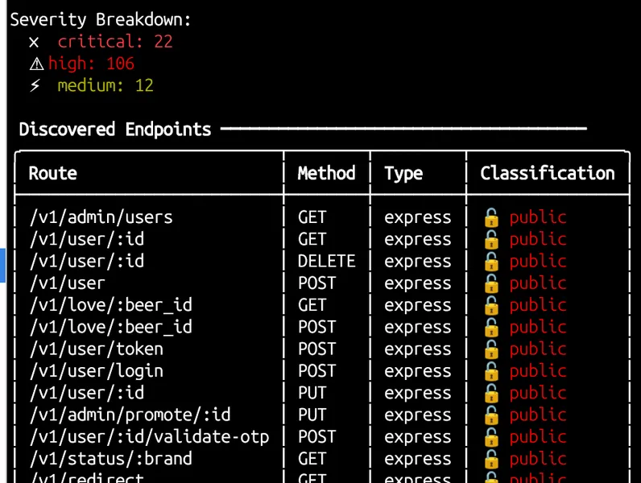
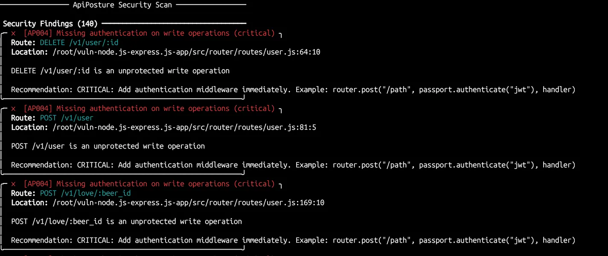

# ApiPosture CLI for Node.js

[](https://github.com/BlagoCuljak/ApiPosture.Node.js/actions/workflows/test.yml)
[](https://www.npmjs.com/package/@apiposture/cli)
[](https://www.npmjs.com/package/@apiposture/cli)
[](https://opensource.org/licenses/MIT)
[](https://nodejs.org/)
[](https://ko-fi.com/blagoculjak)

Static source-code analysis CLI for Node.js API frameworks to identify authorization misconfigurations and security risks.

## Features

- **Multi-Framework Support**: Express.js, NestJS, Fastify, and Koa
- **9 Security Rules**: Covering exposure, consistency, privilege, surface area risks, and hardcoded secrets
- **Multiple Output Formats**: Terminal, JSON, and Markdown
- **Configurable**: Rule customization and suppression support
- **CI/CD Ready**: Exit codes for pipeline integration

### Terminal Output



### Findings Report



## Installation

```bash
npm install -g @apiposture/cli
```

Or use with npx:

```bash
npx @apiposture/cli scan .
```

## Quick Start

```bash
# Scan current directory
apiposture scan

# Scan specific path
apiposture scan ./src

# Output as JSON
apiposture scan -o json

# Output as HTML report
apiposture scan -o html -f report.html

# Fail CI if critical findings
apiposture scan --fail-on critical
```

## Security Rules

| Rule | Name | Severity | Description |
|------|------|----------|-------------|
| AP001 | Public without explicit intent | High | Endpoint is public without @Public or allowAnonymous marker |
| AP002 | AllowAnonymous on write | High | Write operation explicitly marked as public |
| AP003 | Controller/action conflict | Medium | Method @Public overrides class-level guards (NestJS) |
| AP004 | Missing auth on writes | Critical | Unprotected write endpoint |
| AP005 | Excessive role access | Low | Endpoint allows >3 roles |
| AP006 | Weak role naming | Low | Generic role names like "admin", "user" |
| AP007 | Sensitive route keywords | Medium | Public route contains admin/debug/internal |
| AP008 | Unprotected endpoint | High | No middleware chain at all |
| AP201 | Hardcoded secret | High | Vendor-specific credential committed in source or config |

### AP201: Hardcoded secret

AP201 is a deliberately narrow, high-precision rule. It only matches credentials with distinctive formats: AWS access key IDs, GCP API keys, GitHub tokens, GitLab PATs, Stripe live secret/restricted keys (`sk_live_`/`rk_live_`, not `pk_live_`), Slack tokens and webhooks, SendGrid, npm and DigitalOcean tokens, and PEM private key headers. Generic patterns such as `password = "..."`, JWTs or connection strings are not reported.

- Scans `.js`/`.ts`/`.mjs`/`.cjs` files, `.env` files and `.json`/`.yaml`/`.yml` configs.
- Skips `test`, `tests`, `spec`, `__tests__`, `__mocks__`, `fixtures`, `testdata`, `samples`, `examples`, `docs`, `node_modules`, `dist`, `build` and `coverage` directories (relative to the scan root), `*.test.*`/`*.spec.*`, `*.min.js`, lockfiles and source maps.
- Ignores placeholder values (containing `EXAMPLE`, `XXXX`, `your_`, `<`, `${`, `changeme`, `dummy`, `fake`, `sample`, `placeholder`, `redacted`, ...).
- Secrets are never printed in full: only the first 4 characters are shown.
- Disable with `"AP201": { "enabled": false }` in the config file (`--config`), or suppress by file with a `route`/`routePattern` suppression on the relative file path.

## CLI Options

```bash
apiposture scan [path]

Options:
  -o, --output <format>        Output format: terminal, json, markdown, html (default: terminal)
  -f, --output-file <path>     Write output to file
  -c, --config <path>          Config file path (.apiposture.json)
  --severity <level>           Min severity: info, low, medium, high, critical
  --fail-on <level>            Exit code 1 if findings at this level
  --sort-by <field>            Sort by: severity, route, method, classification
  --sort-dir <dir>             Sort direction: asc, desc
  --classification <types>     Filter: public, authenticated, role-restricted, policy-restricted
  --method <methods>           Filter: GET, POST, PUT, DELETE, PATCH
  --route-contains <str>       Filter routes containing string
  --api-style <styles>         Filter: express, nestjs, fastify, koa
  --rule <rules>               Filter by rule ID (comma-separated)
  --no-color                   Disable colors
  --no-icons                   Disable icons
```

## Configuration

Create `.apiposture.json` in your project root:

```json
{
  "rules": {
    "AP001": { "enabled": true },
    "AP005": { "enabled": true, "options": { "maxRoles": 3 } }
  },
  "suppressions": [
    {
      "ruleId": "AP001",
      "route": "/api/health",
      "reason": "Health check is intentionally public"
    }
  ],
  "scan": {
    "excludePatterns": ["**/test/**"]
  }
}
```

## Supported Frameworks

### Express.js
```javascript
app.get('/path', handler);
router.post('/path', authMiddleware, handler);
app.use('/prefix', router);
```

### NestJS
```typescript
@Controller('path')
@UseGuards(AuthGuard)
class MyController {
  @Get()
  @Roles('admin')
  handler() {}
}
```

### Fastify
```javascript
fastify.get('/path', { preHandler: [auth] }, handler);
fastify.route({ method: 'GET', url: '/path', handler });
```

### Koa
```javascript
router.get('/path', authMiddleware, handler);
```

## CI/CD Integration

```yaml
# GitHub Actions
- name: Security Scan
  run: npx @apiposture/cli scan --fail-on high -o json -f report.json
```

```yaml
# GitLab CI
security-scan:
  script:
    - npx @apiposture/cli scan --fail-on critical
```

## License

MIT
